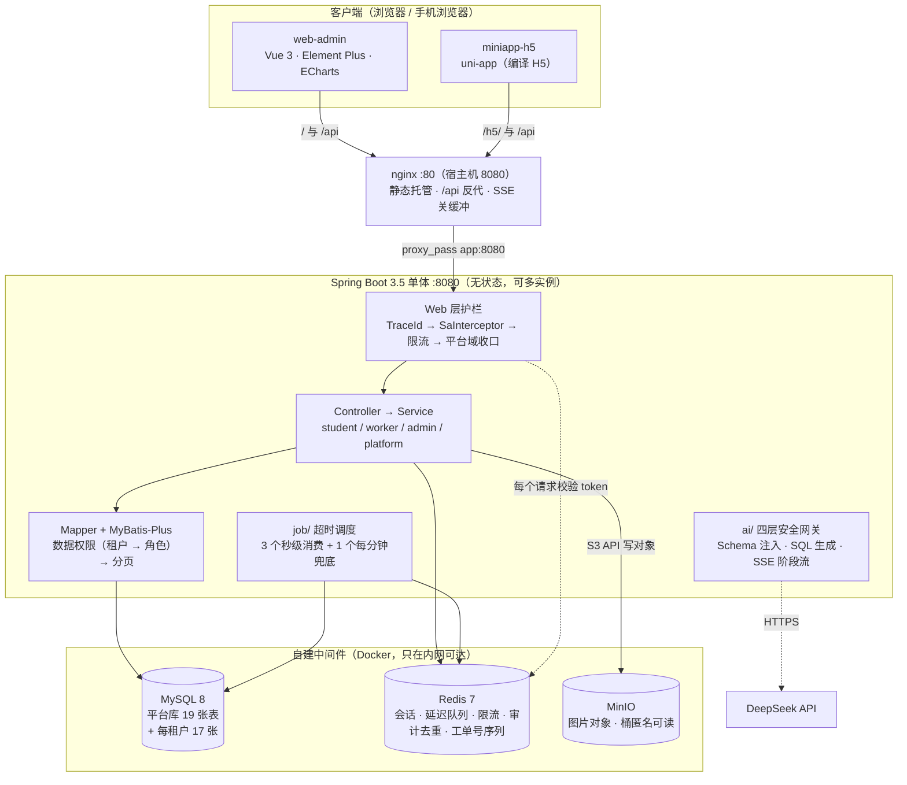

# 高校后勤报修 SaaS 平台（含 AI 数据助手）

> 学生扫码报修 → 后勤派单 → 师傅接单上门 → 学生验收 → 数据自动汇总，并支持用自然语言直接问数据。

[](https://github.com/bluemalic/repair-platform/actions/workflows/ci.yml)
[](LICENSE)
[](https://openjdk.org/projects/jdk/17/)
[](https://spring.io/projects/spring-boot)
[](https://www.mysql.com/)
[](https://redis.io/)
[](https://sa-token.cc/)
[](https://vuejs.org/)
[](https://uniapp.dcloud.net.cn/)
[](https://docs.docker.com/compose/)

**在线演示** <http://119.91.47.63:8080>（管理端；学生 / 维修工端在同地址的 `/h5/`）
**接口文档** 本机启动后 <http://localhost:8080/doc.html>
**项目全景**（进度 / 路线图 / 全链路 / 决策索引）见 [docs/00-项目全景.md](docs/00-项目全景.md)

> **演示站目前是 IP + 8080 的形态**：ICP 备案正在办，域名与 HTTPS 等备案通过后切换（步骤见 [docs/05](docs/05-部署文档.md) §9）。
> 备案期间的唯一功能损失是**浏览器摄像头扫码**——`getUserMedia` 只在 HTTPS 或 localhost 下可用，所以站点上点"扫码"会提示改用手输；
> **手输 6 位报修码始终可用**，报修闭环不受影响。演示账号写在登录页上，站点每天自动恢复原样。

---

## 项目背景

高校后勤维修的日常是**响应慢、流程不透明、数据难统计**：学生报修靠电话或微信群，后勤靠纸笔登记，师傅靠口头派单，工单进度无人知晓，月底统计全靠手工汇总。

本项目把这条链路完整线上化。它同时是三种东西，写在这里是为了让后面每一个"为什么这么写"都有据可依：

- **一个能交付给学校用的系统**：多所学校共用一套部署（租户隔离），每所学校有自己的楼栋、报修码、账号与统计口径
- **一个工程规范型项目**：技术取舍沉淀成 16 条 [ADR](docs/04-架构决策记录.md)，表结构由 Flyway 迁移脚本管，接口契约以 [docs/03](docs/03-接口规范.md) 为准。**宁可少做一个功能，也不留下"说不清为什么这么写"的代码**
- **一份可验证的工程能力清单**：319 个后端测试 + 覆盖率门槛 + 压测报告 + AI 评测集（问数 20 问 + Agent 12 例 + 维修建议 8 例），每一项都有复现命令（见下文「工程质量」）

---

## 核心能力

**报修闭环**（学生 → 后勤 → 师傅 → 学生）

- 扫码或手输 6 位报修码定位房间，提交报修（码能被猜 → 接收报修码的接口按用户限流，ADR-009）；**公共区域没有码可扫** → 报修页还有"手动选位置"入口（位置清单 = 有码的位置，公共区域一个区域一张区域码，ADR-004 补充）
- 8 状态工单状态机，禁止跳状态；接单 / 完工用条件更新（CAS）保证并发幂等
- 超时三节点：24h 未接单提醒 · 48h 未处理升级 · 验收超时自动关闭（Redis ZSet 延迟队列 + 每分钟兜底扫描，ADR-001/006）
- 协同处理：多人同做一单（最多 3 人，先完成者算数）、拆单（只拆一层，原单不动）
- 驳回 / 撤销 / 转派 / 验收不通过打回重做，四条非主线动作各有台账

**多租户与权限**（本项目的技术内核）

- 共享库共享表 + `tenant_id` 判别列，隔离由 MyBatis 拦截器**集中强制**注入，不是每个 SQL 手写条件（ADR-002/008）
- 两层条件且**顺序即语义**：先租户、再角色。后勤不再是"跨租户全可见"，只是"本租户内不受限"
- 未知角色兜底为**恒假**（一条工单也看不到），而不是落回学生口径——出错方向必须是"少看"（ADR-012 的待办已修）
- 平台运营端用「租户 0 + `user_type = 4`」实现，域收口靠拦截器而不是逐个接口加权限码，平台账号碰不到任何租户业务数据

**运维与治理**

- 操作审计：账号与基础数据的写操作留痕；登录成功按「账号 + 天 + 来源 IP」去重、失败不去重；**口令绝不落库**
- 统计看板四接口 + Excel 导出（导出与页面复用同一批 Service 方法，所以不可能出现两个数）
- Redis 淘汰策略用 `volatile-lru` 精确保护没有 TTL 的超时队列，并顺带当内存探针（ADR-016）
- 演示站每日自动重置，保证长期可用

**AI 数据助手**

- 自然语言 → Schema 注入 → SQL 生成 → **四层安全网关** → 只读执行 → 表格 + 图 + 结论
- 四层闸门：只读数据库账号（`GRANT` 与代码白名单同源）· SQL 白名单（单条 `SELECT`，禁子查询 / UNION / CTE / 敏感列）· **强制租户条件**（在 AST 上给每张表注入 `tenant_id`，JOIN 进来的表注到 `ON`）· 3 秒超时中断 + 1000 行截断（ADR-003）
- 流式问数只流「阶段」（`sql` → `data` → `done`），前端用 `fetch` 读流而不是 `EventSource`（ADR-013）

---

## 架构



> 这只是**一张速览**。完整图集（系统上下文 / 容器 / 部署 / 8 张核心时序，全部 Mermaid 且与代码同步维护）见 **[docs/06-架构图.md](docs/06-架构图.md)**——
> 那里的图和代码一起改，README 这张只做入口，**两处不一致时以 `docs/06` 为准**。

---

## 技术栈

| 层次 | 选型 | 版本 |
|---|---|---|
| 语言 / 框架 | Java + Spring Boot | 17 · 3.5.16 |
| ORM | MyBatis-Plus（不用 JPA） | 3.5.17 |
| 数据库 | MySQL 8（本机 Docker 端口 13306） | 8.0 |
| 缓存 / 队列 | Redis 7（会话 · 延迟队列 · 限流 · 审计去重 · 工单号序列） | 7-alpine |
| 对象存储 | MinIO（只依赖 S3 API，不依赖厂商 SDK） | 2025.7 |
| 鉴权 | Sa-Token（不引 Spring Security，只借它的 BCrypt 工具包） | 1.46.0 |
| 接口文档 | springdoc + Knife4j UI（Spring Boot 3.5 下必须这套分工） | 2.8.17 · 4.5.0 |
| AI | LangChain4j（只用稳定核心，不引它的 Spring Boot starter）+ DeepSeek API | 1.20.0 |
| 报表导出 | EasyExcel（已停止更新，接受代价，见 ADR-014） | 4.0.3 |
| 管理端前端 | Vue 3 + Vite + TypeScript + Element Plus + ECharts | 3.5 · 8.3 · 5.9 · 2.14 · 6.1 |
| 移动端前端 | uni-app（Vue 3 语法，先编译 H5，备案后可编小程序） | vite 5.2.8 |
| 部署 | Docker + Docker Compose + Nginx（5 个容器） | —— |
| CI | GitHub Actions（后端与两个前端各自独立工作流） | —— |
| 质量 | JUnit 5 + Mockito + JaCoCo 覆盖率门槛 | JaCoCo 0.8.15 |

> 两个前端的 vite / vue 版本**故意不同**（uni-app 的编译器钉住了自己那一套），不要去"对齐"。

---

## 核心设计

### 1. 多租户与数据权限：两层条件，顺序即语义

数据隔离不靠"每个 SQL 记得写 `where tenant_id = ?`"，而是收敛到 MyBatis 拦截器统一注入：

| 层 | 条件 | 说明 |
|---|---|---|
| 第一层 · 租户 | `tenant_id = 当前租户` | **所有角色都受限**；后勤只是"本租户内不受限"，不是跨租户全可见（ADR-008） |
| 第二层 · 角色 | 学生 `student_id = 我`；维修工 `building_id IN (负责楼栋) OR worker_id = 我 OR id IN (我协作的工单)` | 维修工这三条来源缺一不可——**可见范围必须与操作权一致**，否则跨楼栋派单 / 拉人协作会造出"能派给他、他列表里却没有"的孤儿单 |

维修工那一串 OR **必须加括号**：不加就会渲染成 `租户 AND 楼栋 OR 派给我`，按优先级读成 `(租户 AND 楼栋) OR 派给我`，后两个分支把租户条件整个绕过去了。测试里有一条专门盯这个括号。

未登录态（定时任务）**不注入任何条件**——超时兜底扫描正是靠这一点跨租户处理。这是有意留的口子，别在这里加"默认限制当前租户"。

### 2. 工单状态机：并发靠条件更新，不靠分布式锁

8 种状态 + 合法跃迁表，禁止跳状态。所有流转都走同一条 `conditionalUpdate`：`UPDATE ... WHERE id = ? AND status = 旧状态`，**`rows = 0` 即"状态已被并发改动"**。

于是"两个师傅同时接单""两个人同时点完工"这类问题不需要锁：先到者改成功，后到者被状态条件挡下并拿到明确错误码。单库单学校这个场景里，CAS 就是正确答案，分布式锁是过度设计。

### 3. 超时升级：Redis ZSet 延迟队列 + 兜底扫描

不用定时轮询扫全表。三个节点各一个 ZSet（`ticket:timeout:{ACCEPT|PROCESS|EVAL}`），member 是工单 ID、score 是到期毫秒时间戳：

| 节点 | 触发 | 动作 |
|---|---|---|
| 未接单 | 20 待接单超 24h（基准 `dispatch_time`） | 提醒后勤管理员（**不改状态**） |
| 未处理 | 30 处理中自派单起超 48h | 升级提醒后勤管理员（**不改状态**） |
| 验收 | 50 已完成超 24h 未关闭 | 自动流转 60（唯一会改状态的超时动作） |

- **多实例去重**靠消费时先 `ZREM`、只有返回 1 的实例才处理
- 前两个节点是"记一笔 `ticket_log` + 发通知"，**判重依据就是那笔日志**——兜底扫描每分钟都会扫到同一批超期工单，不判重会把管理员刷屏
- 阈值全部可配（`REPAIR_TIMEOUT_*_MINUTES`），所以统计口径**不在 SQL 里重算阈值**：看板上的每个"超时"都能在 `ticket_log` 里找到那笔触发它的日志（ADR-006）

### 4. Redis 键空间：为什么淘汰策略是 `volatile-lru`

这台 Redis 上住着五类键，其中**只有超时队列的两个 ZSet 没有 TTL**，而它恰恰是唯一"丢了就永久丢"的数据——成员被淘汰意味着那些工单再也不会被超时提醒 / 自动关闭，**而且全程没有任何报错**。

`volatile-lru` 只淘汰设了 TTL 的键，于是"无 TTL 不淘汰"精确等价于"只保护超时队列"。被淘汰的那些都可恢复（会话过期重登、限流计数提前归零、工单号冲突有唯一索引兜底）——降级方向是"麻烦"，不是"数据没了"。

> **约定：除超时队列外，往 Redis 写任何键都必须带 TTL。** 键清单的完整审计、验证方式（起一次性 Redis 压满内存对比两种策略的实测）与"为什么不上独立 DB 号"见 ADR-016。
> 排查入口：`evicted_keys` 非 0 就是内存在告急（[docs/05](docs/05-部署文档.md) §7.1）。

### 5. AI 数据助手：四层闸门

自然语言 → Schema 注入 → SQL 生成 → **安全网关** → 只读执行 → 表格 + 图 + 结论。

1. **只读数据库账号**：应用启动时按代码里的表白名单生成 `GRANT`——**白名单与授权同源**。两处各写一份，迟早会出现"代码允许查但账号没权限"或反过来的漂移
2. **SQL 白名单**：单条 `SELECT`，禁 DDL / DML / 多语句 / UNION / CTE / 敏感列
3. **强制租户条件**：在 AST 上给每张表注入 `tenant_id`（JOIN 进来的表注到 `ON`）
4. **超时 3 秒中断 + 行数上限 1000 行截断**

**子查询被一刀拒绝**（`IN (SELECT ...)`、标量子查询、派生表全禁）。理由值得记下来：注入逻辑只在"外层数据源"上做，子查询里的表拿不到这个条件，于是 `WHERE (SELECT COUNT(*) FROM ticket WHERE tenant_id = 2) > 0` 这种形状能把别家租户的数据算进结果。**这个洞是 AI 评测集跑出来的真缺陷**，不是设计时就想到的（[docs/07](docs/07-AI评测集.md)）。另一条路"递归进每个子查询再注入"被否掉：漏掉一处就是放行，而"多一个 `SELECT` 关键字"是任何子查询都绕不过的硬事实。

### 6. 平台运营端：域收口靠拦截器，不靠权限码

平台运营（开通 / 停用学校、维护各校后勤管理员）用「`tenant_id = 0` + `user_type = 4`」实现，不另起一套认证体系，登录契约一个字没改。

域收口**没有写成"给平台角色只授一个权限码"**：权限码是"有注解才生效"的白名单机制，而项目里有三个接口本来就没有权限码（`GET /api/categories`、`POST /api/files/upload`、`GET /api/tickets/by-code/{code}`），只授一个码挡不住。改成正向陈述——**平台账号被关在 `/api/platform/**` 里**，不依赖任何接口记得加注解，以后新增的租户接口自动被挡住（ADR-012）。

---

## 快速开始

```bash
# 1. 环境变量（数据库密码、Redis 口令等；AI 相关变量只在用问数时需要）
cp .env.example .env

# 2. 启动（表结构与基础数据由应用启动时的 Flyway 迁移自动建立）
docker compose up -d
```

访问接口文档 <http://localhost:8080/doc.html>。**库是空的、没有任何账号**——要能登录试接口，见下面的「演示账号」。

> **在本机跑 `mvn -B clean package`（或在 IDE 里直接起应用）时要先导出 `.env` 里的口令**——
> Spring 不读 `.env` 文件（那是给 `docker compose` 用的），它是从环境变量读的。少了它的症状不是
> "某个用例失败"，而是 **Spring 上下文起不来、整批用例一起报错**：先是 Flyway 报
> `Access denied for user 'root'@... (using password: NO)`（注意 `using password: NO` —— 说明口令压根没传进去），
> 后面跟着一片 `ApplicationContext failure threshold (1) exceeded`。三条映射要顺手做掉（`.env` 里的名字与
> 容器里的不同），测试会真连 MySQL / Redis / MinIO，所以这三个容器得先在跑：
>
> ```bash
> set -a; . ./.env; set +a
> export MYSQL_PASSWORD="$MYSQL_ROOT_PASSWORD"   # .env 里是 MYSQL_ROOT_PASSWORD，容器里是 MYSQL_PASSWORD
> export MINIO_ACCESS_KEY="$MINIO_ROOT_USER" MINIO_SECRET_KEY="$MINIO_ROOT_PASSWORD"
> # REDIS_PASSWORD 两边同名，不用改
> ./mvnw.cmd -B clean package     # Windows；Linux/macOS 用 ./mvnw
> ```
>
> 另外两条容易白折腾的：**跑打包前先停掉正在运行的应用**（`target/*.jar` 被占用时 `clean` 会失败，
> 报"另一个程序正在使用此文件"）；`mvn clean` 会把 `target/` 整个删掉。

### 演示账号（可选，本地开发与演示用）

迁移脚本只建表与基础数据，不含账号。需要时手动执行一次 `docs/dev-seed.sql`，得到三个账号，口令都是 `Repair@2026`：

```bash
docker exec -i repair-mysql mysql -uroot -p"$MYSQL_ROOT_PASSWORD" --default-character-set=utf8mb4 < docs/dev-seed.sql
```

| 登录名 | 角色 | 用途 |
|---|---|---|
| `admin` | 后勤管理 | 派单、统计、AI 问数 |
| `worker01` | 维修工 | 接单、到场、完工（负责 1、2 号楼） |
| `20260001` | 学生 | 提交报修、查看进度、评价 |

> 这个脚本**不挂在** MySQL 的初始化目录上，所以生产库永远不会自动获得这些账号——也就不需要"上线时记得删"。
> ⚠️ 它第一行写死 `USE repair`，要灌到别的库得先改掉那一行。

### 前端怎么起

两个前端是**独立工程**（各有 `package.json`；仓库根目录**不使用** npm workspace 把它们连起来）。

```bash
# 改前端时用 Vite 开发服务器：它会把 /api 代理到本机 8080，后端照上面两条命令起着就行
cd web-admin && npm install && npm run dev       # 管理端 http://localhost:5173
cd miniapp-h5 && npm install && npm run dev:h5
```

要让 nginx 托管（`/` 与 `/h5/`），得先构建出产物——**两个工程的产物路径不同，写错会静默挂上空目录、表现为"页面 403"**：

```bash
cd web-admin && npm run build          # 产物 dist/
cd miniapp-h5 && npm run build:h5      # 产物 dist/build/h5/（uni-app 的约定路径）
```

---

## 目录结构

```
repair-platform/
├── src/main/java/com/bluemalic/repair/
│   ├── common/          统一返回体、业务异常、错误码、领域枚举（状态 / 动作 / 角色）
│   ├── config/          配置类：MyBatis-Plus、Sa-Token、Redis、Knife4j、线程池、超时规则
│   ├── controller/      按端分包：student / worker / admin / platform
│   ├── service/         业务接口
│   │   └── impl/        实现（工单按动作域拆成 Query / Flow / Assignment / Timeout + 共享件）
│   ├── mapper/          MyBatis-Plus Mapper（SQL 只在这里）
│   ├── entity/ dto/ vo/ 实体 / 入参 / 出参（三者严格分离，entity 不进接口）
│   ├── converter/       Entity ↔ DTO ↔ VO
│   ├── interceptor/     数据权限、鉴权、限流、平台域收口、首登强制改密
│   ├── ai/              Schema 注入、SQL 生成、四层安全网关、问数编排与 SSE 流式
│   └── job/             超时调度、演示数据重置、平台账号引导
├── src/main/resources/
│   ├── application.yml  配置全部走 ${ENV_VAR:默认值}；密码与 Key 一律从环境变量读
│   ├── db/migration/    Flyway：V*.sql 是表结构的执行真相，R__seed.sql 是可重复执行的基础数据
│   └── mapper/          MyBatis XML
├── src/test/java/       319 个测试（全部走 HTTP 层，共用一个 Spring 上下文）
├── docs/                00 全景 · 01 需求 · 02 数据库 · 03 接口 · 04 ADR · 05 部署 · 06 架构图 · 07 AI 评测集 · 08 压测报告
├── web-admin/           后勤管理端（Vue 3 + Element Plus + ECharts），产物 dist/
├── miniapp-h5/          学生 / 维修工端（uni-app），产物 dist/build/h5/
├── nginx/               nginx 配置（/ 与 /h5/ 两个静态目录 + /api 反代 + SSE 关缓冲）
├── scripts/loadtest/    压测生成器（本机跑，目标可指向服务器）
├── Dockerfile · docker-compose.yml
└── .github/workflows/   ci.yml（测试与打包）· deploy.yml（CD）· frontend-ci.yml · miniapp-ci.yml
```

---

## 工程质量

| 项 | 现状 | 复现方式 |
|---|---|---|
| 测试 | **319 个**：状态机流转 / 并发幂等 / 数据权限（含跨租户越权） / 超时调度 / 统计口径 / 鉴权与限流边界 / 接口错误契约 / AI 安全网关与问数链路 / 审计 / 导出 / 协同与拆单 / **Agent 编排（受理·分诊：假模型驱动，含"草稿不落库"与"模型把 id 写成字符串也要接受"断言）** / **阶段 6 租户路由与建库（两套结构脚本逐列比对 / 开通学校即建它自己的库并路由过去 / 存量租户仍在平台库 / 未知租户报错不回落）** / **阶段 6 存量搬迁（搬运计划不漏表 / 搬完逐表校验一致 / 源库在搬之后被写过必须发现且拒绝切换 / 切换后写入落在新库、平台库那份保留 / 已切过的学校不许再搬 / **回退演练**）** / **阶段 6 第 3 步（已搬家学校的超时升级只写它自己的库：兜底扫描逐库、队列成员带租户、日志与通知都落在该校库里，平台库查不到）** / **阶段 7 统一认证（两种协议用真 HTTP 验：PKCE / CAS ticket / 属性映射；完整登录链路：state 与登录码都一次性、不自动建号、防开放重定向、复用登录审计；Mock IdP 两种协议与一次性凭据）** | `mvn -B clean package` |
| 覆盖率 | JaCoCo 门槛：`service.impl` 行覆盖 **≥85%**（当前实测 91.9%）、整包 **≥80%**（当前实测 87.3%）；报告在 `target/site/jacoco/index.html` | 同上（门槛绑在 `test` 阶段，就在这条命令里） |
| AI 问数准确率 | 20 问评测集 **39/40 符合预期**；评测同时揪出"子查询绕过租户注入""LEFT JOIN 注入落点错"两个真缺陷 | 手动跑（要花钱），见 [docs/07](docs/07-AI评测集.md) |
| 性能 | 2C2G 口径下提交 / 列表 / 看板 / 混合四个场景，含目标达成情况与瓶颈定位 | `scripts/loadtest/`，见 [docs/08](docs/08-压测报告.md) |
| CI/CD | 四个独立工作流：后端（真连 MySQL / Redis / MinIO 跑测试 + 覆盖率门槛 + 打包）、两个前端各自 typecheck + build、**CD（测试门槛 + 传源码 + 服务器本地构建 + 健康检查与失败回滚；前端独立链）** | GitHub Actions 页面 |
| 数据结构 | 表结构只走 Flyway 迁移（平台库 19 张表 / 租户库 17 张），基础数据走可重复执行的 `R__seed.sql` | 应用启动时自动执行 |

> **CD 已打通并验证**（2026-10-16）：**推 `main` 自动部署**（纯文档改动用 `paths-ignore` 挡掉、不触发）；流程是 `verify`（测试 + 覆盖率门槛）→ 传源码 → **服务器本地构建** → 重启 → 健康检查（**轮询**，失败自动回滚），前端另有一条独立链（含 `VITE_DEMO_ACCOUNTS` 注入与 **HTTP 层验收**）。设计经过四次实测迭代（跨境推镜像 0.3 Mbps、镜像站 502 等），依据在 [docs/05](docs/05-部署文档.md) §6.4。
> 前端目前是**零测试**（只有类型检查与构建），这是后续要补的一项。

---

## 当前进度与路线图

完整全景（含缺口表与全链路图）见 **[docs/00-项目全景.md](docs/00-项目全景.md)**。

### 已交付

| 里程碑 | 内容 | 状态 |
|---|---|---|
| M1 | 工程骨架 + 三端账号与权限（Sa-Token + RBAC + 数据范围） | ✅ |
| M2 | 工单全流程 + 8 状态机 + 数据权限拦截器 + 报修码 | ✅ |
| M3 | 站内通知 · 超时升级三节点 · 统计看板四接口 | ✅ |
| M4 | AI 数据助手 + SQL 安全网关（四层闸门 + SSE 流式 + 管理端页面 + 评测集） | ✅ |
| M5 | 管理端 11 个业务页面 + 学生 / 维修工端全流程（含扫码，手输兜底） | ✅ |
| M5 | 部署上线：Docker Compose + nginx，**公网演示站已验证**；CD ✅ **已验证**（手动触发跑通全流程） | ✅ |
| — | 平台运营端（开通 / 停用学校）· 操作审计 · Excel 导出 · 协同与拆单 · 登录审计 · 工单服务四域重构 | ✅ |
| — | 地基修复：未知角色兜底改恒假 · Redis 淘汰策略 · 覆盖率门槛（ADR-016） | ✅ |
| — | **AI Agent：报修受理 + 智能分诊**（手写编排循环 + 工具白名单，**Agent 不写库**——只产草稿 / 建议，落单仍走原接口；ADR-017） | ✅ |
| — | **维修知识库 + 师傅排查建议**（阶段 2：ngram 中文检索 + 引用核对，ADR-018；管理端维护页 + 师傅端建议） | ✅ |
| — | **派单评分模型**（阶段 3：技能 / 满意度 / 负载 / 距离四项加权，逐项可解释，ADR-019；只排序不自动派单） | ✅ |
| — | **阶段 5 平台设施**：租户配额（建号 / 导入校验，超限 30004）· 鉴权与类别缓存（Redis，故障降级）· 轻量指标（ADR-020） | ✅ |
| — | **阶段 6 第 1 步：租户路由与建库**（开通学校即建 `repair_<编码>` + 跑租户库迁移；请求按登录态路由到各校自己的库，未知租户**报错**不回落；两套迁移脚本逐列比对 + 平台种子逐行比对；ADR-021） | ✅ |
| — | **阶段 6 第 2 步：存量租户搬迁工具**（建库 → 逐表搬 → **逐表校验：结构 + 行数 + 全列校验和** → 一致才切；复制阶段不影响师生使用，切换只有几秒且该校请求被挡；三个平台接口 + 两条审计；ADR-021） | ✅ |
| — | **阶段 6 第 3 步：定时任务按租户遍历**（延迟队列成员带租户 ID、兜底扫描逐库、处理逻辑按租户钉路由、演示重置写进该校自己的库；ADR-021） | ✅ |
| — | **阶段 7 统一认证适配器 + Mock IdP**（CAS / OAuth2 两种协议；一次性 state + PKCE + 一次性登录码，token 不进 URL；复用 completeLogin 与审计；**平台页有配置界面**；自带 Mock IdP 供演示；ADR-022） | ✅ |

### 下一阶段（规划中）

方向是从"查数工具"升级为"AI 系统"，并补齐多租户与交付面的短板。每个阶段结束都能独立演示，不是"全部做完才第一次跑通"。

| 阶段 | 内容 | 价值 |
|---|---|---|
| ~~1~~ | ~~AI Agent 编排（手写 ReAct 循环 + 工具白名单 + human-in-the-loop）+ 报修受理 / 智能分诊~~ **已完成**（2026-10-16：后端 + H5 对话页 + 12 例评测集，评测还揪出一条"长 id 被静默丢弃"的缺陷） | 从"查数"到"办事" |
| ~~2~~ | ~~RAG 维修知识库 + 维修辅助建议~~ **已完成**（2026-10-17：MySQL ngram 中文检索 + 一次生成 + **服务端核对引用**；8 例评测全过，向量检索留接口） | 师傅排查建议 |
| ~~3~~ | ~~派单评分模型（技能 / 距离 / 负载 / 满意度，每项得分可解释）~~ **已完成**（2026-10-17：四项加权 + 逐项明细，**只排序不自动派单**；距离用楼栋归属代理） | 可解释的调度算法 |
| ~~4~~ | ~~CD 打通（含前端产物上传）~~ **已完成**（2026-10-16） | "自动测试 + 自动上线"闭环 |
| ~~5~~ | ~~租户级配额 · 权限与字典缓存 · 轻量可观测性（指标暴露 + 自定义业务指标）~~ **已完成**（2026-10-18：配额 30004、鉴权/类别缓存、`/actuator/prometheus` + 两个业务指标，ADR-020） | 多租户公平性与可运维 |
| **6** | **租户隔离模型升级：共享表 → 每租户独立 Schema**（✅ **三步全部完成**，ADR-021：新学校自动建库、存量学校可搬迁切换、定时任务按租户遍历；现有 `tenant_id` 列与拦截器**保留**作双保险） | 逐租户升级 / 备份 / 导出 / 下线；"串库"会**报错**而不是静默读别家数据 |
| ~~7~~ | ~~统一认证适配器 + Mock IdP（CAS / OAuth2 对接，为高校真实环境准备）~~ **已完成**（2026-10-19：两种协议 + Mock IdP + 一次性登录码，ADR-022） | 校园系统对接能力 |
| ~~8~~ | ~~录屏演示 + 文档收尾~~ **文档收尾已完成**（2026-10-19：全仓口径复核 + `docs/09-演示脚本.md`）；**录屏按脚本自行录制** | 交付闭环 |

> **为什么第 6 阶段夹在中间**（2026-10-16 定）：**排在配额之后**——租户配额是跨租户的计数，在一个库里做最省事，先迁移再配额会让每次配额读取变成跨库 fan-out；**排在统一认证之前**——schema 路由的挂点就是登录时写租户那条路（`CurrentTenantService.bind`），SSO 只是第二个登录入口，先把这个挂点定稳，SSO 接上去就是复用。开工第一步不是改代码，而是**ADR（隔离边界 + 控制面/数据面划分）+ 一个 spike**（只验两件事：每租户库上 Flyway 各跑一遍、路由切换不会污染连接池）。

---

## 文档

| 文档 | 什么时候读 |
|---|---|
| [00 项目全景](docs/00-项目全景.md) | **第一次接触项目**——进度、路线图、全链路图、文档索引 |
| [01 需求文档](docs/01-需求文档.md) | 要加功能前——确认这事在"必做"清单里，而不是在"明确不做"里 |
| [02 数据库设计](docs/02-数据库设计.md) | 涉及表结构、字段、索引时 |
| [03 接口规范](docs/03-接口规范.md) | 写接口时——返回体、错误码表、分页、鉴权 |
| [04 架构决策记录](docs/04-架构决策记录.md) | 想换技术方案时——**先看有没有做过的决策**（22 条：Redis 延迟队列 / 数据权限拦截器 / AI 四层闸门 / 多租户两层条件 / 限流 / Flyway / 平台域收口 / 四域拆分 / Redis 键空间 / 每租户一库 / 统一认证 …） |
| [05 部署文档](docs/05-部署文档.md) | 部署、发布、排查——服务器初始化、环境变量、迁移、备份、常用命令 |
| [06 架构图](docs/06-架构图.md) | 想看系统怎么连起来——系统上下文 / 容器 / 部署 / 8 张核心时序（Mermaid，与代码同改） |
| [07 AI 评测集](docs/07-AI评测集.md) | 改提示词 / 安全网关 / 模型之后——20 问准确率与已踩过的坑 |
| [08 压测报告](docs/08-压测报告.md) | 改索引 / SQL / 连接池 / 线程池之后——性能目标与复测方法 |
| [09 演示脚本](docs/09-演示脚本.md) | 演示 / 答辩 / 录屏时——9 个场景的顺序、话术与翻车点 |

---

## 开发约定

- 分支：`main`（始终可部署）+ 短生命周期的 `feature/*`、`fix/*`、`docs/*`；**每个功能走分支 + PR**，不直接推 `main`
- 提交：[Conventional Commits](https://www.conventionalcommits.org/)，前端 scope 固定用 `admin`（管理端）与 `h5`（学生 / 维修工端）
- **合并用 PR + `--rebase`** 保持线性历史——所以 `git log` 里看不到 merge commit，别误以为"没走 PR"（`gh pr list --state merged` 才是真实记录）
- **代码与文档同一个 PR**，不允许"下个 PR 补"：改表结构 → 迁移脚本 + `docs/02`；改接口 / 错误码 → `docs/03`；换技术取舍 → `docs/04` 加一条 ADR；进度与测试数 → 本文档 + `docs/00`
- 提交前：后端 `mvn -B clean package`（含测试与覆盖率门槛）；改了前端则对应工程 `npm run build` 通过
- 不设长期 `develop` 分支：单人项目里它只会带来"哪个分支才是可部署版本"的歧义
- **`main` 尚未开启分支保护**（单人项目，重写历史时需要留 `force-push` 的口子）。多人协作时应开启保护并禁用强推
- 代码格式计划后续接入 Spotless（CI 里已预留检查步骤，当前未启用）

---

## License

[MIT](LICENSE)
