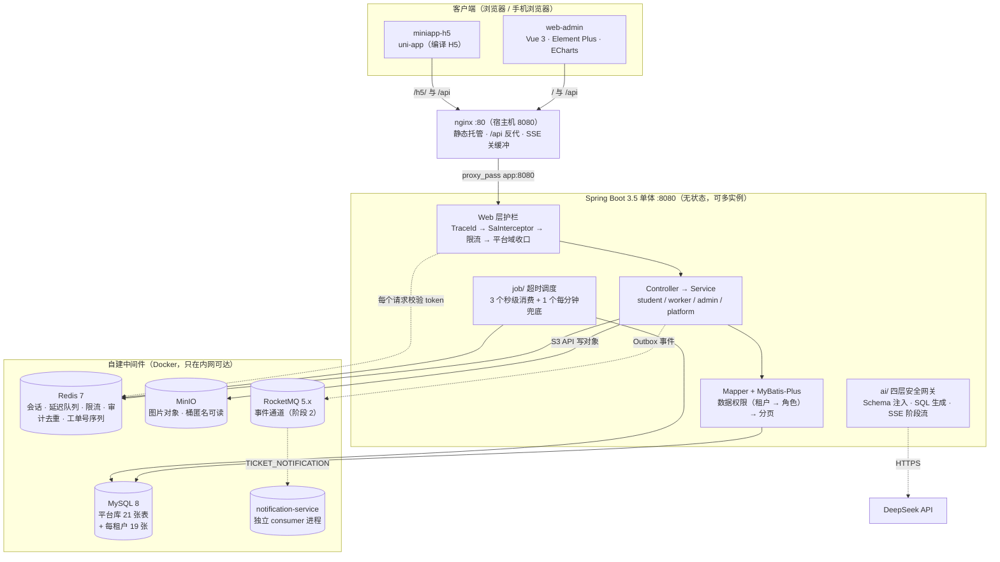

# 高校后勤报修 SaaS 平台（含 AI 数据助手）

> 学生扫码报修 → 后勤派单 → 师傅接单上门 → 学生验收 → 数据自动汇总，并支持用自然语言直接问数据。

[](https://github.com/bluemalic/repair-platform/actions/workflows/ci.yml)
[](LICENSE)
[](https://openjdk.org/projects/jdk/17/)
[](https://spring.io/projects/spring-boot)
[](https://baomidou.com/)
[](https://www.mysql.com/)
[](https://redis.io/)
[](https://rocketmq.apache.org/)
[](https://sa-token.cc/)
[](https://min.io/)
[](https://github.com/langchain4j/langchain4j)
[](https://vuejs.org/)
[](https://uniapp.dcloud.net.cn/)
[](https://nginx.org/)
[](https://docs.docker.com/compose/)

**在线演示** <https://bluemalic.cn/>（首页；管理端登录 `/login`，学生 / 维修工端 `/h5/`）
**接口文档** 本机启动后 <http://localhost:8080/doc.html>
**项目全景**（进度 / 路线图 / 全链路 / 决策索引）见 [docs/00-项目全景.md](docs/00-项目全景.md)

---

## 项目背景

高校后勤维修的日常是**响应慢、流程不透明、数据难统计**：学生报修靠电话或微信群，后勤靠纸笔登记，师傅靠口头派单，工单进度无人知晓，月底统计全靠手工汇总。

---

## 核心能力

**报修闭环**（学生 → 后勤 → 师傅 → 学生）

- 扫码或手输 6 位报修码定位房间，提交报修（码能被猜 → 接收报修码的接口按用户限流，ADR-009）；**公共区域没有码可扫** → 报修页还有"手动选位置"入口（位置清单 = 有码的位置，公共区域一个区域一张区域码，ADR-004 补充）
- 8 状态工单状态机，禁止跳状态；接单 / 完工用条件更新（CAS）保证并发幂等
- 超时三节点：24h 未接单提醒 · 48h 未处理升级 · 验收超时自动关闭（Redis ZSet 延迟队列 + 每分钟兜底扫描，ADR-001/006）
- 协同处理：多人同做一单（最多 3 人，先完成者算数）、拆单（只拆一层，原单不动）
- 驳回 / 撤销 / 转派 / 验收不通过打回重做，四条非主线动作各有台账

**多租户与权限**（本项目的技术内核）

- 共享库共享表 + `tenant_id` 判别列，隔离由 MyBatis 拦截器**集中强制**注入，不是每个 SQL 手写条件（ADR-002/008）
- 两层条件且**顺序即语义**：先租户、再角色。后勤不再是"跨租户全可见"，只是"本租户内不受限"
- 未知角色兜底为**恒假**（一条工单也看不到），而不是落回学生口径——出错方向必须是"少看"（ADR-012 的待办已修）
- 平台运营端用「租户 0 + `user_type = 4`」实现，域收口靠拦截器而不是逐个接口加权限码，平台账号碰不到任何租户业务数据

**运维与治理**

- 操作审计：账号与基础数据的写操作留痕；登录成功按「账号 + 天 + 来源 IP」去重、失败不去重；**口令绝不落库**
- 统计看板四接口 + Excel 导出（导出与页面复用同一批 Service 方法，所以不可能出现两个数）
- Redis 淘汰策略用 `volatile-lru` 精确保护没有 TTL 的超时队列，并顺带当内存探针（ADR-016）
- 演示站每日自动重置，保证长期可用

**AI 数据助手**

- 自然语言 → Schema 注入 → SQL 生成 → **四层安全网关** → 只读执行 → 表格 + 图 + 结论
- 四层闸门：只读数据库账号（`GRANT` 与代码白名单同源）· SQL 白名单（单条 `SELECT`，禁子查询 / UNION / CTE / 敏感列）· **强制租户条件**（在 AST 上给每张表注入 `tenant_id`，JOIN 进来的表注到 `ON`）· 3 秒超时中断 + 1000 行截断（ADR-003）
- 流式问数只流「阶段」（`sql` → `data` → `done`），前端用 `fetch` 读流而不是 `EventSource`（ADR-013）

---

## 架构



> 这只是**一张速览**。完整图集（系统上下文 / 容器 / 部署 / 8 张核心时序，全部 Mermaid 且与代码同步维护）见 **[docs/06-架构图.md](docs/06-架构图.md)**——
> 那里的图和代码一起改，README 这张只做入口，**两处不一致时以 `docs/06` 为准**。

---

## 技术栈

| 层次 | 选型 | 版本 |
|---|---|---|
| 语言 / 框架 | Java + Spring Boot | 17 · 3.5.16 |
| ORM | MyBatis-Plus（不用 JPA） | 3.5.17 |
| 数据库 | MySQL 8（本机 Docker 端口 13306） | 8.0 |
| 缓存 / 队列 | Redis 7（会话 · 延迟队列 · 限流 · 审计去重 · 工单号序列） | 7-alpine |
| 对象存储 | MinIO（只依赖 S3 API，不依赖厂商 SDK） | 2025.7 |
| 鉴权 | Sa-Token（不引 Spring Security，只借它的 BCrypt 工具包） | 1.46.0 |
| 接口文档 | springdoc + Knife4j UI（Spring Boot 3.5 下必须这套分工） | 2.8.17 · 4.5.0 |
| AI | LangChain4j（只用稳定核心，不引它的 Spring Boot starter）+ DeepSeek API | 1.20.0 |
| 报表导出 | EasyExcel（已停止更新，接受代价，见 ADR-014） | 4.0.3 |
| 管理端前端 | Vue 3 + Vite + TypeScript + Element Plus + ECharts | 3.5 · 8.3 · 5.9 · 2.14 · 6.1 |
| 移动端前端 | uni-app（Vue 3 语法，先编译 H5，备案后可编小程序） | vite 5.2.8 |
| 部署 | Docker + Docker Compose + Nginx（5 个容器） | nginx 1.27 |
| CI | GitHub Actions（后端与两个前端各自独立工作流） | —— |
| 质量 | JUnit 5 + Mockito + JaCoCo 覆盖率门槛 | JaCoCo 0.8.15 |

> 两个前端的 vite / vue 版本**故意不同**（uni-app 的编译器钉住了自己那一套），不要去"对齐"。

---

## 快速开始

```bash
# 1. 环境变量（数据库密码、Redis 口令等；AI 相关变量只在用问数时需要）
cp .env.example .env

# 2. 启动（表结构与基础数据由应用启动时的 Flyway 迁移自动建立）
docker compose up -d
```

访问接口文档 <http://localhost:8080/doc.html>。**库是空的、没有任何账号**——要能登录试接口，见下面的「演示账号」。

> **在本机跑 `mvn -B clean package`（或在 IDE 里直接起应用）时要先导出 `.env` 里的口令**——
> Spring 不读 `.env` 文件（那是给 `docker compose` 用的），它是从环境变量读的。少了它的症状不是
> "某个用例失败"，而是 **Spring 上下文起不来、整批用例一起报错**：先是 Flyway 报
> `Access denied for user 'root'@... (using password: NO)`（注意 `using password: NO` —— 说明口令压根没传进去），
> 后面跟着一片 `ApplicationContext failure threshold (1) exceeded`。三条映射要顺手做掉（`.env` 里的名字与
> 容器里的不同），测试会真连 MySQL / Redis / MinIO，所以这三个容器得先在跑：
>
> ```bash
> set -a; . ./.env; set +a
> export MYSQL_PASSWORD="$MYSQL_ROOT_PASSWORD"   # .env 里是 MYSQL_ROOT_PASSWORD，容器里是 MYSQL_PASSWORD
> export MINIO_ACCESS_KEY="$MINIO_ROOT_USER" MINIO_SECRET_KEY="$MINIO_ROOT_PASSWORD"
> # REDIS_PASSWORD 两边同名，不用改
> ./mvnw.cmd -B clean package     # Windows；Linux/macOS 用 ./mvnw
> ```
>
> 另外两条容易白折腾的：**跑打包前先停掉正在运行的应用**（`target/*.jar` 被占用时 `clean` 会失败，
> 报"另一个程序正在使用此文件"）；`mvn clean` 会把 `target/` 整个删掉。

### 演示账号（可选，本地开发与演示用）

迁移脚本只建表与基础数据，不含账号。需要时手动执行一次 `docs/dev-seed.sql`，得到三个账号，口令都是 `Repair@2026`：

```bash
docker exec -i repair-mysql mysql -uroot -p"$MYSQL_ROOT_PASSWORD" --default-character-set=utf8mb4 < docs/dev-seed.sql
```

| 登录名 | 角色 | 用途 |
|---|---|---|
| `admin` | 后勤管理 | 派单、统计、AI 问数 |
| `worker01` | 维修工 | 接单、到场、完工（负责 1、2 号楼） |
| `20260001` | 学生 | 提交报修、查看进度、评价 |

> 这个脚本**不挂在** MySQL 的初始化目录上，所以生产库永远不会自动获得这些账号——也就不需要"上线时记得删"。
> ⚠️ 它第一行写死 `USE repair`，要灌到别的库得先改掉那一行。

### 前端怎么起

两个前端是**独立工程**（各有 `package.json`；仓库根目录**不使用** npm workspace 把它们连起来）。

```bash
# 改前端时用 Vite 开发服务器：它会把 /api 代理到本机 8080，后端照上面两条命令起着就行
cd web-admin && npm install && npm run dev       # 管理端 http://localhost:5173
cd miniapp-h5 && npm install && npm run dev:h5
```

要让 nginx 托管（`/` 与 `/h5/`），得先构建出产物——**两个工程的产物路径不同，写错会静默挂上空目录、表现为"页面 403"**：

```bash
cd web-admin && npm run build          # 产物 dist/
cd miniapp-h5 && npm run build:h5      # 产物 dist/build/h5/（uni-app 的约定路径）
```

---

## 目录结构

```
repair-platform/
├── src/main/java/com/bluemalic/repair/
│   ├── common/          统一返回体、业务异常、错误码、领域枚举（状态 / 动作 / 角色）
│   ├── config/          配置类：MyBatis-Plus、Sa-Token、Redis、Knife4j、线程池、超时规则
│   ├── controller/      按端分包：student / worker / admin / platform
│   ├── service/         业务接口
│   │   └── impl/        实现（工单按动作域拆成 Query / Flow / Assignment / Timeout + 共享件）
│   ├── mapper/          MyBatis-Plus Mapper（SQL 只在这里）
│   ├── entity/ dto/ vo/ 实体 / 入参 / 出参（三者严格分离，entity 不进接口）
│   ├── converter/       Entity ↔ DTO ↔ VO
│   ├── interceptor/     数据权限、鉴权、限流、平台域收口、首登强制改密
│   ├── ai/              Schema 注入、SQL 生成、四层安全网关、问数编排与 SSE 流式
│   └── job/             超时调度、Outbox relay、幂等记录清理、演示数据重置、平台账号引导
├── src/main/resources/
│   ├── application.yml  配置全部走 ${ENV_VAR:默认值}；密码与 Key 一律从环境变量读
│   ├── db/migration/    Flyway：V*.sql 是表结构的执行真相，R__seed.sql 是可重复执行的基础数据
│   └── mapper/          MyBatis XML
├── src/test/java/       345 个测试（集成测试走 HTTP 层，共用一个 Spring 上下文）
├── docs/                00 全景 · 01 需求 · 02 数据库 · 03 接口 · 04 ADR · 05 部署 · 06 架构图 · 07 AI 评测集 · 08 压测报告 · 09 演示脚本
├── web-admin/           后勤管理端（Vue 3 + Element Plus + ECharts），产物 dist/
├── miniapp-h5/          学生 / 维修工端（uni-app），产物 dist/build/h5/
├── nginx/               nginx 配置（/ 与 /h5/ 两个静态目录 + /api 反代 + SSE 关缓冲）
├── scripts/loadtest/    压测生成器（本机跑，目标可指向服务器）
├── Dockerfile · docker-compose.yml
└── .github/workflows/   ci.yml（测试与打包）· deploy.yml（CD）· frontend-ci.yml · miniapp-ci.yml
```

---

## 开发进度

按实际开发顺序排列；完整全景（缺口表与全链路图）见 **[docs/00-项目全景.md](docs/00-项目全景.md)**。

1. 工程骨架 + 三端账号与权限（Sa-Token + RBAC + 数据范围）
2. 工单全流程 + 8 状态机 + 数据权限拦截器 + 报修码
3. 站内通知 · 超时升级三节点 · 统计看板
4. AI 数据助手 + SQL 安全网关（四层闸门 + SSE 流式 + 评测集）
5. 管理端 11 个业务页面 + 学生 / 维修工端全流程（含扫码，手输兜底）
6. 部署上线：Docker Compose + nginx，公网演示站已验证；CD 打通（推 `main` 自动部署）
7. 平台运营端（开通 / 停用学校）· 操作审计 · Excel 导出 · 协同与拆单 · 登录审计 · 工单服务四域拆分
8. 地基修复：未知角色兜底改恒假 · Redis 淘汰策略 · 覆盖率门槛
9. AI Agent：报修受理 + 智能分诊（手写编排循环 + 工具白名单，只产草稿 / 建议，不写库）
10. 维修知识库 + 师傅排查建议（ngram 中文检索 + 服务端核对引用）
11. 派单评分模型（技能 / 满意度 / 负载 / 距离四项加权，只排序不自动派单）
12. 租户配额 · 鉴权与类别缓存 · 轻量指标
13. 多租户隔离升级：开通学校即建独立库、存量学校搬迁工具、定时任务按租户遍历
14. 统一认证适配器 + Mock IdP（CAS / OAuth2，一次性登录码）
15. 文档收尾 + 演示脚本（录屏按 [docs/09](docs/09-演示脚本.md) 自行录制）

---

## 文档

| 文档 | 什么时候读 |
|---|---|
| [00 项目全景](docs/00-项目全景.md) | **第一次接触项目**——进度、路线图、全链路图、文档索引 |
| [01 需求文档](docs/01-需求文档.md) | 要加功能前——确认这事在"必做"清单里，而不是在"明确不做"里 |
| [02 数据库设计](docs/02-数据库设计.md) | 涉及表结构、字段、索引时 |
| [03 接口规范](docs/03-接口规范.md) | 写接口时——返回体、错误码表、分页、鉴权 |
| [04 架构决策记录](docs/04-架构决策记录.md) | 想换技术方案时——**先看有没有做过的决策**（22 条：Redis 延迟队列 / 数据权限拦截器 / AI 四层闸门 / 多租户两层条件 / 限流 / Flyway / 平台域收口 / 四域拆分 / Redis 键空间 / 每租户一库 / 统一认证 …） |
| [05 部署文档](docs/05-部署文档.md) | 部署、发布、排查——服务器初始化、环境变量、迁移、备份、常用命令 |
| [06 架构图](docs/06-架构图.md) | 想看系统怎么连起来——系统上下文 / 容器 / 部署 / 8 张核心时序（Mermaid，与代码同改） |
| [07 AI 评测集](docs/07-AI评测集.md) | 改提示词 / 安全网关 / 模型之后——20 问准确率与已踩过的坑 |
| [08 压测报告](docs/08-压测报告.md) | 改索引 / SQL / 连接池 / 线程池之后——性能目标与复测方法 |
| [09 演示脚本](docs/09-演示脚本.md) | 演示 / 答辩 / 录屏时——9 个场景的顺序、话术与翻车点 |

---

## 开发约定

- 分支：`main`（始终可部署）+ 短生命周期的 `feature/*`、`fix/*`、`docs/*`；**每个功能走分支 + PR**，不直接推 `main`
- 提交：[Conventional Commits](https://www.conventionalcommits.org/)，前端 scope 固定用 `admin`（管理端）与 `h5`（学生 / 维修工端）
- **合并用 PR + `--rebase`** 保持线性历史——所以 `git log` 里看不到 merge commit，别误以为"没走 PR"（`gh pr list --state merged` 才是真实记录）
- **代码与文档同一个 PR**，不允许"下个 PR 补"：改表结构 → 迁移脚本 + `docs/02`；改接口 / 错误码 → `docs/03`；换技术取舍 → `docs/04` 加一条 ADR；进度与测试数 → 本文档 + `docs/00`
- 提交前：后端 `mvn -B clean package`（含测试与覆盖率门槛）；改了前端则对应工程 `npm run build` 通过
- 不设长期 `develop` 分支：单人项目里它只会带来"哪个分支才是可部署版本"的歧义
- **`main` 尚未开启分支保护**（单人项目，重写历史时需要留 `force-push` 的口子）。多人协作时应开启保护并禁用强推
- 代码格式计划后续接入 Spotless（CI 里已预留检查步骤，当前未启用）

---

## License

[MIT](LICENSE)
